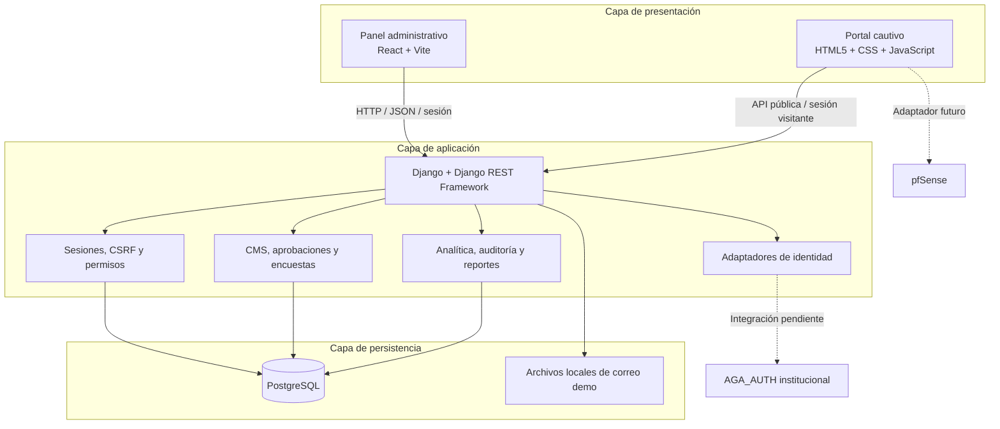

# 🏛️ PortalInfo UHO
## Portal cautivo y sistema de gestión de contenidos de la Universidad de Holguín

**PortalInfo UHO** es una aplicación web para la administración de contenidos y la presentación de información institucional mediante un portal cautivo. La solución organiza la gestión editorial, la publicación de noticias, eventos, avisos, servicios y encuestas, y ofrece un portal público/visitante conectado a una API propia.

El proyecto está implementado como una demostración funcional local para Windows y Visual Studio Code. Su núcleo utiliza **Django REST Framework y PostgreSQL**, el panel administrativo está desarrollado con **React y Vite**, y el portal cautivo utiliza **HTML5, CSS y JavaScript nativo**.

> **Alcance de la entrega:** esta versión funciona en entorno local con identidades ficticias. No autentica usuarios con AGA_AUTH, no modifica pfSense ni concede acceso a Internet. Las integraciones AGA_AUTH, pfSense, SMTP institucional, SIGENU y ASSET requieren contratos y validación de la Universidad. No utilizar credenciales institucionales reales.

---

## 📌 Tabla de contenidos

1. [Descripción general](#-descripción-general)
2. [Objetivos](#-objetivos)
3. [Características principales](#-características-principales)
4. [Módulos funcionales](#-módulos-funcionales)
5. [Arquitectura del sistema](#-arquitectura-del-sistema)
6. [Stack tecnológico](#-stack-tecnológico)
7. [Roles y control de acceso](#-roles-y-control-de-acceso)
8. [Flujos de trabajo](#-flujos-de-trabajo)
9. [Estructura del repositorio](#-estructura-del-repositorio)
10. [Requisitos previos](#-requisitos-previos)
11. [Instalación en Windows](#-instalación-en-windows)
12. [Ejecución desde Visual Studio Code](#-ejecución-desde-visual-studio-code)
13. [Direcciones locales](#-direcciones-locales)
14. [Cuentas de demostración](#-cuentas-de-demostración)
15. [API REST y documentación](#-api-rest-y-documentación)
16. [Seguridad y privacidad](#-seguridad-y-privacidad)
17. [Pruebas y estado de verificación](#-pruebas-y-estado-de-verificación)
18. [Documentación adicional](#-documentación-adicional)
19. [Limitaciones y trabajo pendiente](#-limitaciones-y-trabajo-pendiente)
20. [Mantenimiento y solución de problemas](#-mantenimiento-y-solución-de-problemas)
21. [Contribución](#-contribución)
22. [Licencia](#-licencia)

---

## 📝 Descripción general

PortalInfo UHO separa la gestión interna del contenido de la experiencia de consulta del portal cautivo. Los administradores trabajan desde un panel React; el backend Django aplica las reglas de negocio, la autorización y la persistencia; el portal liviano consulta los contenidos publicados mediante endpoints públicos.

La aplicación permite crear y administrar categorías, gestionar contenidos y sus revisiones, aprobar publicaciones, administrar encuestas, registrar interacciones, consultar indicadores y generar reportes. Los datos editoriales, las respuestas y las métricas se almacenan en PostgreSQL.

La autenticación disponible para la demostración utiliza cuentas ficticias separadas para el panel CMS y para el portal. Los adaptadores de identidad institucional existen como frontera de integración, pero el proveedor institucional no está conectado.

## 🎯 Objetivos

- Centralizar la administración de información que se presenta en el portal cautivo.
- Separar el panel de gestión de la interfaz liviana de consulta.
- Permitir la administración de noticias, eventos, avisos, servicios y encuestas.
- Controlar las operaciones por rol, categoría y permiso.
- Mantener revisiones y versiones aprobadas de los contenidos.
- Proporcionar estadísticas, auditoría y exportaciones para la gestión.
- Mantener una base técnica preparada para futuras integraciones institucionales, sin simular que ya están conectadas.

## 🚀 Características principales

- Panel administrativo SPA con React y Vite.
- API REST implementada con Django REST Framework.
- Persistencia PostgreSQL y migraciones incrementales.
- Roles Superadmin, Admin y Gestor.
- Permisos configurables por usuario/rol, categoría y operación.
- Gestión de categorías dinámicas y nomencladores jerárquicos.
- CMS para noticias, eventos, avisos, servicios, encuestas y contenido genérico.
- Flujo editorial de borrador, envío, aprobación/rechazo e historial de versiones.
- Portal HTML5/CSS/JavaScript nativo, sin React ni CDN en el artefacto final.
- Acceso visitante de demostración separado del acceso CMS.
- Estadísticas, logs de acceso, vistas, alertas defensivas y auditoría.
- Notificaciones internas y almacenamiento local de correos de demostración.
- Exportación de reportes en CSV y PDF.
- Documentación de API mediante OpenAPI 3.0.3 y Swagger UI.
- Scripts PowerShell para comprobación, arranque y pruebas en Windows.

## 🧩 Módulos funcionales

| Módulo | Responsabilidad |
|---|---|
| Cuentas y autenticación | Usuarios, roles, sesiones, proveedores de identidad y bloqueo de intentos |
| Permisos | Concesiones por usuario o rol, categoría y operación |
| Catálogos | Tipos de catálogo, valores jerárquicos y categorías dinámicas |
| Configuración | Preferencias generales, límites, duración de sesión y parámetros de seguridad |
| Gestión de contenidos | CRUD, validación, estados editoriales, visibilidad y vigencia |
| Aprobaciones | Cola, comparación de revisiones, aprobación y rechazo motivado |
| Encuestas | Preguntas, opciones, respuestas, deduplicación y resultados |
| Portal visitante | Sesión visitante independiente, navegación y consumo de información pública |
| Analítica | Estadísticas por período, vistas, registros de acceso y métricas |
| Seguridad y auditoría | Eventos de seguridad, señales para revisión y trazabilidad |
| Notificaciones | Bandeja, contador, lectura y salida local de correo |
| Reportes | Exportación CSV/PDF con filtros y controles de acceso |

## 🏗️ Arquitectura del sistema

La aplicación se organiza en tres componentes funcionales, conectados a través del backend.

### Diagrama de arquitectura



### Descripción de las capas

**Presentación**
- **Panel administrativo:** aplicación React/Vite. Proporciona login, navegación por módulos, tablas, formularios, estadísticas, aprobaciones y reportes.
- **Portal cautivo:** documento HTML autónomo con CSS y JavaScript nativo. Obtiene configuración, categorías y publicaciones desde la API. Django sirve la ruta local `/portal/`.

**Aplicación**
- Django concentra validación de entradas, autenticación de demostración, control de permisos, lógica editorial, encuestas y API.
- Django REST Framework implementa los endpoints REST.
- Los servicios de contenido y aprobación mantienen separada la revisión de trabajo de la última versión pública aprobada.
- Los módulos de analítica y auditoría registran interacciones y generan información para el panel.

**Persistencia**
- PostgreSQL guarda usuarios CMS, roles, permisos, catálogos, categorías, contenidos, publicaciones, aprobaciones, respuestas, notificaciones, registros y configuración.
- Los correos de prueba se escriben en el directorio local `.local/mail` cuando se habilita esa preferencia. No se contacta SMTP institucional.

### Tecnologías y comunicación

El panel y el portal se comunican con Django mediante HTTP y JSON, con sesiones y protección CSRF. La API y la documentación OpenAPI se publican localmente en el backend. PostgreSQL se utiliza tanto para los datos funcionales como para las sesiones del entorno de demostración.

## 🛠️ Stack tecnológico

| Área | Tecnología | Uso |
|---|---|---|
| Lenguaje backend | Python 3.11+ | Lógica del servidor |
| Framework backend | Django 5.2 | Aplicación web y ORM |
| API | Django REST Framework 3.18 | Servicios REST |
| Base de datos | PostgreSQL 16 | Persistencia |
| Driver DB | psycopg 3 | Conexión PostgreSQL |
| Frontend administrativo | React 19 | Interfaz SPA |
| Herramienta frontend | Vite 7 | Desarrollo y compilación |
| Enrutamiento | React Router 7 | Navegación del panel |
| Gráficos | Chart.js 4 | Visualización de métricas |
| Servidor local Windows | Waitress 3 | Servir Django en la demostración |
| Documentación API | drf-spectacular / OpenAPI 3.0.3 | Esquema y Swagger |
| Reportes PDF | ReportLab | Generación PDF |
| Pruebas frontend | Vitest / Testing Library | Pruebas de componentes |
| Pruebas de navegador | Playwright | Pruebas locales con Chrome |
| Portal cautivo | HTML5, CSS y JavaScript nativo | Interfaz independiente y liviana |

Las versiones exactas verificadas se encuentran en `backend/requirements.lock.txt` y `frontend/package-lock.json`.

## 🔐 Roles y control de acceso

El sistema implementa tres roles administrativos. Las capacidades administrativas reservadas se mantienen como fronteras de seguridad; las operaciones editoriales se complementan con concesiones específicas.

| Rol | Descripción | Permisos principales |
|---|---|---|
| **SUPERADMIN** | Responsable de la administración global | Gestionar usuarios y roles, asignar permisos, crear/eliminar categorías, configurar seguridad, consultar auditoría y administrar contenidos |
| **ADMIN** | Administrador funcional | Administrar Gestores, configurar visibilidad/límites y nomencladores, gestionar contenidos y aprobar/rechazar publicaciones |
| **GESTOR** | Responsable de contenidos | Crear y editar contenidos en categorías asignadas, consultar y enviar revisiones para aprobación |

Las concesiones editoriales se definen por sujeto (usuario o rol), categoría y operación: `view`, `create`, `edit`, `delete` y `submit`. El backend verifica los permisos; ocultar un botón en React no sustituye la autorización del servidor.

El portal visitante utiliza una identidad/sesión distinta de la cuenta CMS. Una cuenta visitante no obtiene permisos administrativos ni concede conectividad a Internet.

## 🔄 Flujos de trabajo

### Publicación de una noticia

1. Un Gestor con categoría y permisos asignados crea una noticia.
2. Guarda la noticia como borrador.
3. Envía la revisión a aprobación.
4. Un Admin o Superadmin revisa la propuesta y la aprueba o rechaza. El rechazo requiere motivo.
5. Al aprobarse, se publica la versión aprobada si también cumple visibilidad, vigencia y límites de categoría.
6. El portal consulta la publicación desde la API.

Una edición posterior del Gestor vuelve a generar una revisión. La versión pública anterior permanece visible hasta que se apruebe la nueva. El Gestor no puede aprobar su propio contenido.

### Encuestas

1. El Gestor crea una encuesta y define preguntas/opciones dentro de los límites configurados.
2. Envía la encuesta para aprobación.
3. Un Admin o Superadmin la aprueba.
4. Un visitante o usuario autorizado responde, según la política de autenticación de esa encuesta.
5. Django valida estado, versión, opciones, obligatoriedad y duplicación.
6. El panel consulta resultados y puede exportarlos a CSV o PDF.

### Notificaciones y reportes

El sistema registra notificaciones para eventos editoriales relevantes. La bandeja permite consultar y marcar mensajes como leídos. El correo de demostración se almacena localmente. Los módulos de estadísticas y reportes filtran datos por período y permisos.

## 📂 Estructura del repositorio

Estructura funcional resumida del repositorio:

```text
PortalInfo-UHO/
├── README.md
├── PARA_EL_TUTOR.md
├── .env.example
├── backend/
│   ├── config/
│   │   ├── settings.py
│   │   ├── urls.py
│   │   └── wsgi.py
│   ├── apps/
│   │   ├── accounts/        # Usuarios, roles, permisos y proveedores
│   │   ├── approvals/       # Cola y decisiones editoriales
│   │   ├── audit/           # Eventos y contexto de auditoría
│   │   ├── analytics/       # Métricas, logs, alertas y reportes
│   │   ├── catalogs/        # Catálogos y categorías
│   │   ├── content/         # Contenido, versiones y encuestas
│   │   ├── notifications/   # Bandeja y correo local
│   │   ├── portal/          # Identidad y sesión visitante
│   │   └── settings_app/    # Configuración persistente
│   ├── manage.py
│   ├── requirements.txt
│   ├── requirements-dev.txt
│   ├── requirements.lock.txt
│   └── requirements-production.txt
├── frontend/
│   ├── src/
│   │   ├── api/
│   │   ├── components/
│   │   ├── contexts/
│   │   ├── layouts/
│   │   ├── pages/
│   │   ├── routes/
│   │   └── styles/
│   ├── package.json
│   └── vite.config.js
├── captive-portal/
│   ├── src/                 # HTML, CSS y JavaScript fuente
│   ├── dist/                # HTML autónomo compilado
│   ├── tests/
│   └── build.mjs
├── scripts/
│   ├── iniciar_backend.ps1
│   ├── iniciar_frontend.ps1
│   ├── iniciar_portal.ps1
│   ├── verificar_entorno.ps1
│   ├── probar_sistema.ps1
│   ├── serve_backend.py
│   ├── smoke_final_http.py
│   └── respaldar_base.py
└── docs/
    ├── arquitectura/
    ├── manuales/
    ├── pruebas/
    └── requisitos/
```

Los directorios `.env` y `.local/` contienen configuración/estado privado del entorno. No deben incorporarse a capturas públicas ni compartirse como código fuente.

## 💻 Requisitos previos

Para instalar en un equipo Windows nuevo:

- Windows 10/11.
- Python 3.11 o superior.
- Node.js 22.12 o superior.
- PostgreSQL 16 y herramientas `pg_dump` / `pg_restore`.
- Git.
- Visual Studio Code (recomendado).

La demostración validada se ejecuta sin Docker. No se requiere instalar un servidor independiente para el portal cautivo: Django sirve esa ruta.

## 📦 Instalación en Windows

### 1. Obtener el código

Clona el repositorio desde una terminal donde Git tenga acceso autorizado:

```powershell
git clone https://github.com/secondhack/PortalInfo-UHO.git
cd PortalInfo-UHO
code .
```

Si ya tienes el repositorio local, abre la carpeta `PortalInfo-UHO` con **Archivo → Abrir carpeta** en VS Code.

### 2. Crear el entorno Python

Desde la raíz del proyecto:

```powershell
python -m venv .venv
.\.venv\Scripts\python.exe -m pip install -r backend\requirements-dev.txt
```

### 3. Instalar dependencias del frontend

```powershell
npm.cmd --prefix frontend ci --no-audit --no-fund
```

### 4. Configurar el entorno

Si todavía no existe `.env`, copia `.env.example` a `.env` y sustituye las claves y credenciales de ejemplo por valores aleatorios propios. No sobrescribas un `.env` válido. No compartas su contenido.

La demostración local utiliza proveedor de identidad demo, sesión visitante demo y correo en modo archivo. La configuración de producción rechaza el proveedor demo y DEBUG.

### 5. Preparar PostgreSQL en una instalación nueva

Solo para una instalación completamente nueva, con PostgreSQL 16 disponible y sin una base de trabajo existente:

```powershell
.\scripts\start-database.cmd
.\.venv\Scripts\python.exe scripts\create_database.py
.\.venv\Scripts\python.exe backend\manage.py migrate
.\.venv\Scripts\python.exe backend\manage.py seed_demo
.\.venv\Scripts\python.exe backend\manage.py seed_portal_demo
node captive-portal/build.mjs
powershell.exe -NoProfile -ExecutionPolicy Bypass -File scripts\verificar_entorno.ps1
```

No ejecutes estos pasos de bootstrap sobre la instalación que ya contiene datos: consulta primero `docs/manuales/INSTALACION.md`. No uses `flush`, no borres migraciones y no reemplaces PostgreSQL por SQLite.

## ▶️ Ejecución desde Visual Studio Code

Abre la carpeta raíz del proyecto en Visual Studio Code. Usa tres terminales integradas independientes. No es necesario ejecutar VS Code como administrador.

Primero comprueba el entorno:

```powershell
powershell.exe -NoProfile -ExecutionPolicy Bypass -File scripts\verificar_entorno.ps1
```

**Terminal 1 — Backend Django/Waitress**

```powershell
powershell.exe -NoProfile -ExecutionPolicy Bypass -File scripts\iniciar_backend.ps1
```

**Terminal 2 — Panel administrativo React/Vite**

```powershell
powershell.exe -NoProfile -ExecutionPolicy Bypass -File scripts\iniciar_frontend.ps1
```

**Terminal 3 — Compilar y verificar el portal**

```powershell
powershell.exe -NoProfile -ExecutionPolicy Bypass -File scripts\iniciar_portal.ps1
```

El tercer script comprueba el artefacto y que Django ya sirve el portal; **no inicia un tercer servidor**. Deja abiertas las terminales de Backend y Administración mientras utilizas el sistema.

Alternativas directas:

```powershell
.\.venv\Scripts\python.exe -u scripts\serve_backend.py
npm.cmd --prefix frontend run dev
```

Para detener la demostración, pulsa **Ctrl+C** en las terminales de React y Django. PostgreSQL puede permanecer activo. No detengas procesos de otros proyectos.

## 🌐 Direcciones locales

| Servicio | Dirección |
|---|---|
| Panel administrativo React | http://127.0.0.1:5174 |
| Portal cautivo | http://127.0.0.1:8010/portal/ |
| Estado de backend y PostgreSQL | http://127.0.0.1:8010/api/health/ |
| Swagger UI | http://127.0.0.1:8010/api/docs/ |
| Esquema OpenAPI | http://127.0.0.1:8010/api/schema/ |

PostgreSQL del proyecto utiliza el puerto local **55432**. Los puertos ajenos 8000, 5173 y 5432 se conservan para no interferir con otras aplicaciones.

No abras el portal mediante `file://`: las sesiones, cookies y protección CSRF necesitan acceder a través del servidor local.

## 👥 Cuentas de demostración

Las credenciales ficticias se guardan localmente en:

- `.local/demo-credentials.txt`: cuentas Superadmin, Admin y Gestor del CMS.
- `.local/portal-demo-credentials.txt`: cuentas visitantes del portal.

No publiques esos archivos, no los incluyas en capturas y no utilices contraseñas reales de la UHO.

En una instalación nueva se pueden crear las semillas con:

```powershell
.\.venv\Scripts\python.exe backend\manage.py seed_demo
.\.venv\Scripts\python.exe backend\manage.py seed_portal_demo
```

Los comandos son idempotentes y conservan las cuentas/contraseñas existentes. No es necesario volver a ejecutarlos en un entorno ya inicializado.

## 🔌 API REST y documentación

La API está documentada con **OpenAPI 3.0.3** y Swagger UI. La documentación en ejecución se encuentra en:

- Swagger: `/api/docs/`
- Esquema OpenAPI: `/api/schema/`

Grupos funcionales principales:

| Grupo | Funcionalidad |
|---|---|
| Diagnóstico | Estado de backend y conexión con PostgreSQL |
| Autenticación CMS | Login, logout, sesión y usuario actual |
| Administración | Usuarios, roles, permisos, categorías, catálogos y configuración |
| CMS | Contenidos, envío, visibilidad, revisión e historial |
| Aprobaciones | Cola y decisión de solicitudes |
| Notificaciones | Bandeja personal y marcado de lectura |
| Analítica | Estadísticas, logs, señales defensivas y resultados |
| Reportes | Exportaciones CSV/PDF con autorización |
| Portal público | Configuración, categorías y publicaciones visibles |
| Visitantes | Sesión visitante demo, logout y registro de actividad |
| Encuestas | Consulta y envío de respuestas con validaciones del servidor |

La API devuelve JSON. Las rutas, parámetros, esquemas, permisos y respuestas de error están descritos en OpenAPI y en `docs/arquitectura/CONTRATOS.md`.


## 🛡️ Seguridad y privacidad

La demostración incorpora controles de aplicación, pero no equivale a una instalación institucional:

- Contraseñas ficticias CMS/visitante almacenadas con hash de Django.
- Sesiones persistidas en PostgreSQL, rotación al autenticar y cierre de sesión en servidor.
- Cookies HttpOnly y protección CSRF.
- Validación y autorización en el backend, no solo en la interfaz.
- Bloqueo de intentos y límites de solicitudes.
- Respuestas privadas con política `no-store`.
- Auditoría sin registrar contraseñas ni tokens.
- Identidades visitantes independientes de usuarios y roles CMS.
- Configuración de producción que rechaza DEBUG y proveedores demo.

**Protección de archivos y datos**
- No compartas `.env`, `.local/`, credenciales ni respaldos.
- No publiques cuentas ficticias ni capturas que muestren información de acceso.
- No copies datos institucionales reales al entorno de pruebas.
- Mantén el repositorio privado cuando contenga datos de revisión o configuración no pública.

## 🧪 Pruebas y estado de verificación

La última entrega documentada registra:

| Suite | Resultado |
|---|---:|
| Django/PostgreSQL | 118 aprobadas |
| React/Vitest | 26 aprobadas |
| Portal/DOM | 17 aprobadas |
| Playwright/Chrome | 12 aprobadas |
| **Total** | **173 aprobadas, 0 fallidas y 0 omitidas** |

Además, `scripts/smoke_final_http.py` completó 29 comprobaciones HTTP reales, informadas aparte y no sumadas al total de tests.

Otras verificaciones de la entrega:
- Compilación de React correcta.
- OpenAPI validado sin avisos/errores de generación.
- Dependencias Python y Node verificadas.
- 36 migraciones aplicadas; la entrega final no requirió migraciones nuevas.
- Portal final de 24 539 bytes sin gzip, por debajo del límite documentado de 204 800 bytes.
- La suite y las mediciones detalladas se encuentran en `docs/pruebas/RESULTADOS.md`.

**Límites de las pruebas:** las mediciones locales no certifican carga institucional sostenida. La concurrencia de 200 conexiones permanece parcial; la ráfaga API está limitada por cuota y debe interpretarse según el informe. Tampoco se acredita aceptación física en Android/iOS/WebViews ni certificación WCAG completa.

## 📚 Documentación adicional

| Documento | Contenido |
|---|---|
| `docs/manuales/INSTALACION.md` | Preparación en un equipo Windows nuevo |
| `docs/manuales/COMO_PROBAR_EN_VSCODE.md` | Guía detallada de demostración en VS Code |
| `docs/manuales/USO.md` | Operación general del sistema |
| `docs/manuales/SUPERADMIN.md` | Funciones del Superadmin |
| `docs/manuales/ADMIN.md` | Funciones del Admin |
| `docs/manuales/GESTOR.md` | Gestión de contenidos |
| `docs/manuales/PORTAL_CAUTIVO.md` | Portal, sesión visitante y API |
| `docs/manuales/MANTENIMIENTO.md` | Respaldo, restauración y mantenimiento |
| `docs/manuales/DESPLIEGUE_ORIENTATIVO.md` | Notas orientativas para despliegue futuro |
| `docs/arquitectura/ARQUITECTURA.md` | Decisiones y arquitectura técnica |
| `docs/arquitectura/MODELO_DATOS.md` | Entidades, relaciones y restricciones |
| `docs/arquitectura/PERMISOS.md` | Matriz de permisos y fronteras de confianza |
| `docs/arquitectura/CONTRATOS.md` | Contratos REST |
| `docs/arquitectura/openapi.yaml` | Esquema OpenAPI |
| `docs/arquitectura/TRAZABILIDAD.md` | Requisitos, estado, evidencia y limitaciones |
| `docs/arquitectura/ENTREGA_FINAL.md` | Informe final de la entrega local |
| `docs/arquitectura/TODO.md` | Pendientes y dependencias |
| `docs/pruebas/RESULTADOS.md` | Evidencias e historial de pruebas |

## ⚠️ Limitaciones y trabajo pendiente

La versión actual es funcional para demostración local, no un despliegue institucional. Permanecen pendientes o sin aceptación institucional:

1. **AGA_AUTH:** autenticación institucional real, sujeta a contrato y entorno autorizados.
2. **pfSense:** conexión con el sistema de red y autorización de acceso, sin cambios automáticos en la demostración.
3. **SMTP:** envío mediante correo institucional; actualmente el modo de demostración escribe mensajes localmente.
4. **SIGENU y ASSET:** integración y sincronización real de datos.
5. **Producción:** validación de TLS, Docker, Linux, Nginx/Gunicorn, caché compartida y recuperación real desde respaldo.
6. **Rendimiento:** aceptación de carga sostenida y concurrencia en la infraestructura universitaria.
7. **Accesibilidad e identidad visual:** pruebas exhaustivas WCAG y revisión formal contra el Manual de Identidad de la UHO.
8. **Dispositivos físicos:** verificación en teléfonos/tabletas Android e iOS y WebViews.
9. **Repositorio institucional:** el requisito de publicación/pipeline remoto permanece pendiente según el alcance decidido para esta entrega.

Los archivos Docker y configuraciones Nginx existentes se consideran material técnico orientativo; no significan que el despliegue de producción haya sido ejecutado o validado.

## 🔧 Mantenimiento y solución de problemas

| Situación | Acción recomendada |
|---|---|
| PostgreSQL no responde | Comprueba estado del clúster del proyecto y parámetros locales del `.env`; no recrees una base existente |
| Falta `.venv` o una dependencia | Sigue `docs/manuales/INSTALACION.md` |
| Puerto 8010 ocupado | Comprueba qué proceso pertenece al proyecto; no detengas servicios de otras aplicaciones |
| Puerto 5174 ocupado | Comprueba otra instancia Vite del proyecto |
| Error CSRF o sesión vencida | Usa `127.0.0.1` consistentemente, recarga e inicia sesión otra vez |
| Usuario sin permisos | Comprueba rol, categoría asignada y concesión de la operación |
| Contenido no visible | Comprueba aprobación, vigencia, switch, categoría y límite de publicaciones |
| Error 429 | Respeta el tiempo de bloqueo/cuota; no desactives las protecciones |

Para respaldos y restauración utiliza los procedimientos de `docs/manuales/MANTENIMIENTO.md`. La herramienta de restauración está diseñada para rechazar destinos existentes; no ejecutes restauraciones sobre la base de trabajo.

## 🤝 Contribución

Para preparar cambios de código o documentación:

1. Revisa primero la arquitectura y los manuales relacionados.
2. Mantén las reglas de autorización en el backend.
3. No elimines migraciones ni reinicies bases con datos.
4. Añade o actualiza pruebas para los cambios funcionales.
5. Actualiza OpenAPI y la documentación cuando cambien los contratos.
6. No introduzcas credenciales, datos reales ni archivos privados en commits.

Los cambios de infraestructura institucional requieren revisión y autorización de los responsables correspondientes.

## 📄 Licencia

No se declara una licencia de código abierto en este README porque no se ha confirmado una licencia aplicable al repositorio. Consulta con los responsables del proyecto antes de reutilizar o redistribuir el código.

---

**PortalInfo UHO — Universidad de Holguín**

Proyecto de demostración local para la gestión y publicación de contenidos del portal cautivo.


 
