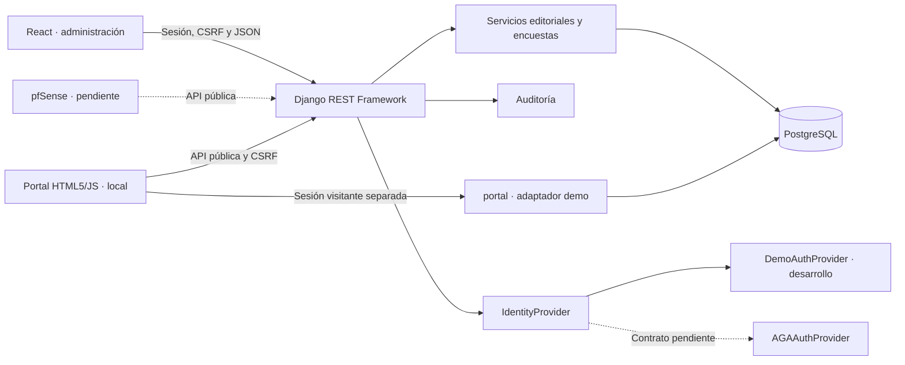

# Arquitectura de PortalInfo UHO · Entrega final local

Fuente principal: SRS 1.0 (2025), PDF original de 24 folios en docs/requisitos. El HTML original es la referencia visual. Los nombres REQUERIMIENTOS.pdf/MOCKUP.html del encargo se corresponden con esos archivos existentes; no se sustituyen ni modifican.

Django/DRF concentra validación, autorización y persistencia PostgreSQL. React/Vite proporciona administración. El portal pfSense permanece separado en captive-portal. Los modelos y servicios existentes se ampliaron con trece migraciones incrementales después del Bloque 1; no se reinició PostgreSQL.

accounts gestiona usuarios, roles y concesiones; catalogs mantiene tipos/valores jerárquicos y categorías; settings_app persiste configuración y dashboard; audit registra acciones y denegaciones. content y approvals implementan CMS y revisiones. notifications gestiona inbox y salida de correo; analytics implementa métricas, vistas, logs, alertas y reportes. Solo la integración SMTP institucional continúa pendiente.

Content conserva la revisión de trabajo y Publication cada versión aprobada. services.py gestiona transacciones de guardado/envío/revisión/expiración; queries.py centraliza elegibilidad temporal y límites por categoría mediante ranking SQL. Submission/Response conserva participaciones por versión sin modificar preguntas respondidas. Contratos, calendario y reglas en BLOQUE_2.md.

Sesiones Django persistidas en PostgreSQL: cookies HttpOnly, rotación al autenticar, invalidación real al salir, expiración configurable y renovación deslizante. Sin tokens en localStorage. CSRF protege login y votos anónimos. Bloqueo de login por IP basado en auditoría persistente. Rate limiting general y de encuestas usa caché local en desarrollo; varios workers requieren caché compartida. NUM_PROXIES=0 impide confiar en X-Forwarded-For arbitrario. Se usa REMOTE_ADDR.

Las contraseñas demo usan hash Django. Las cuentas no demo no reciben contraseña utilizable. AGAAuthProvider responde 503 hasta obtener contrato institucional. Producción rechaza DEBUG/proveedor demo, habilita cookies Secure, HTTPS y HSTS; falta validar el proxy TLS real. PORTALINFO_DEBUG evita colisiones con DEBUG heredado del entorno.

Decisiones y ambigüedades:

- RF-01/RNF-20/regla 18 prohíben contraseñas locales: el encargo autoriza solo la excepción demo, explícita y bloqueada en producción. No se declara integración AGA_AUTH cumplida.
- RF-03: se registra correo/rol/categorías y contraseña demo opcional; no se fabrican nombre, DNI, foto ni datos obtenidos supuestamente de AGA_AUTH.
- RF-38/49/50: Admin configura límites/visibilidad y nomencladores. Crear/eliminar categorías y cambiar seguridad queda reservado al Superadmin.
- El Superadmin no puede eliminarse, desactivarse ni degradarse por API. Los permisos se validan en servidor, además de adaptar navegación.
- El mockup contiene acciones y métricas simuladas: se reutiliza paleta azul/naranja, sidebar, tablas y tarjetas; los datos del producto provienen de API real.
- La revisión pendiente/rechazada nunca se publica; puede conservarse una versión anterior aprobada. Se separan estado editorial, switch, fechas, sección y máximo visible.
- Eliminar contenido es lógico para conservar respuestas, aprobaciones y auditoría. La retención dispone de simulación y aplicación controlada por comando autorizado, sin borrado administrativo por API.
- No se habilita SMTP real ni se contactan sistemas institucionales. El Manual de Identidad Visual no está adjunto; conformidad formal y WCAG requieren revisión.

Requisitos generales 2.1–2.8: cobertura parcial mediante diseño adaptable, feedback, etiquetas/teclado, ORM, CSRF, registros restringidos, OpenAPI, modularidad y nomencladores editables. Rendimiento/carga, consentimiento, despliegue y retención necesitan validación en sus contextos reales.

Clúster de desarrollo independiente en 127.0.0.1:55432, con credenciales aleatorias en .env excluido del control de versiones. Se conserva el servidor PostgreSQL existente 5432 y aplicaciones en 8000/5173; PortalInfo usa 8010/5174.

## Extensión del Bloque 3

Approval.proposal congela el envío; los endpoints de cola delegan en los servicios editoriales bloqueados de Content. Notification y MailDelivery se persisten con claves de evento y envío tras commit. El backend de correo es intercambiable y la demo utiliza disco/consola/memoria, sin red institucional.

Los períodos se calculan centralmente en analytics/periods.py; metrics.py agrega en PostgreSQL; services.py registra contexto validado; security.py detecta señales configurables; reports.py exporta con permisos/filtros y defensas CSV/PDF. audit/context.py centraliza proxies de confianza y resúmenes permitidos. Antes/después excluye contraseñas/tokens.

Chart.js se registra por componentes y se empaqueta en chunk separado; ReportLab genera PDF. requirements-dev incluye pypdf para validar PDF y extraer el SRS. La interfaz no depende de un servicio de gráficos externo. Diseño, contratos, límites y riesgos de idempotencia/identidad/retención detallados en BLOQUE_3.md.

## Portal funcional · Bloque 4

captive-portal separa fuentes HTML/CSS/JS de un artefacto minificado inline de 24539 bytes. Estilos propios compatibles con un subconjunto Bootstrap 5, sin distribución completa, CDN ni React. Django sirve /portal/ para simulación; el HTML puede desplegarse estáticamente con proxy/orígenes explícitos autorizados. No se cambia red/pfSense real.

apps.portal separa visitantes del modelo User y del login CMS. DemoVisitorProvider valida hashes privados ficticios; InstitutionalVisitorProvider devuelve 503 hasta recibir contrato. portal_visitor usa sesión Django persistida, rotación y vencimiento; nunca concede permisos administrativos ni Internet. analytics.identity_from y SurveyAnswerView reutilizan identidad verificada en servidor, sin confiar en uid/tipo de JSON.

Sesión/contenidos tienen peticiones y errores independientes, timeout 8 s y alternativa XHR. Configuración/categorías generan navegación; las publicaciones se obtienen bajo demanda del núcleo visible_publications. Un fallo editorial no bloquea login; la caída completa del backend local sí afecta ambos. Esa separación lógica no implica alta disponibilidad física.

Sin tablas/migraciones nuevas: 36 aplicadas conservadas. OpenAPI añade sesión/logout visitantes e include_contents=false compatible. Medidas/límites en PORTAL_CAUTIVO.md y RENDIMIENTO_BLOQUE_4.json: loopback/runserver no certifican RNF-01/02/03.

## Cierre del Bloque 5

Windows utiliza scripts/serve_backend.py con Waitress: loopback 8010, ocho hilos, backlog/connection_limit 256 y tiempos/tamaños de petición acotados. StaticFilesHandler sirve recursos Swagger locales en DEBUG. PostgreSQL conserva conexiones hasta 60 s por hilo con health checks, configurable DATABASE_CONN_MAX_AGE; no se reinicia el clúster. React sigue en 5174; el tercer script verifica el portal servido por Django, sin otro servidor.

Los intentos CMS/portal se serializan por IP mediante bloqueo asesor transaccional PostgreSQL, en namespaces separados. Respuestas privadas usan no-store y se auditan denegaciones del portal. La vigencia virtual default se transforma en rango custom al guardar; usa los días configurados sin cambiar las opciones almacenadas ni fechas anteriores. Valores extremos de fechas/duración se rechazan.

React ignora respuestas tardías de búsquedas, reutiliza diálogos con foco/Escape y mejora errores de conexión/tablas móviles. Playwright es dependencia de desarrollo: Chrome local usa un perfil temporal aislado en .local, prueba 18 rutas administrativas, pestañas, formularios, cinco anchos del portal y flujos reales de encuesta/descargas. No forma parte del HTML ni depende de servicios remotos.

No se crean tablas/migraciones nuevas. scripts/probar_sistema.ps1 reutiliza/conserva test_portalinfo con --keepdb; los hilos de tests cierran explícitamente sus conexiones. La limpieza se limita a datos propios de comprobación (contenidos lógicamente retirados, usuarios propios desactivados); no se borra contenido de usuarios. Requisitos remotos/institucionales se mantienen explícitos en la matriz final.
